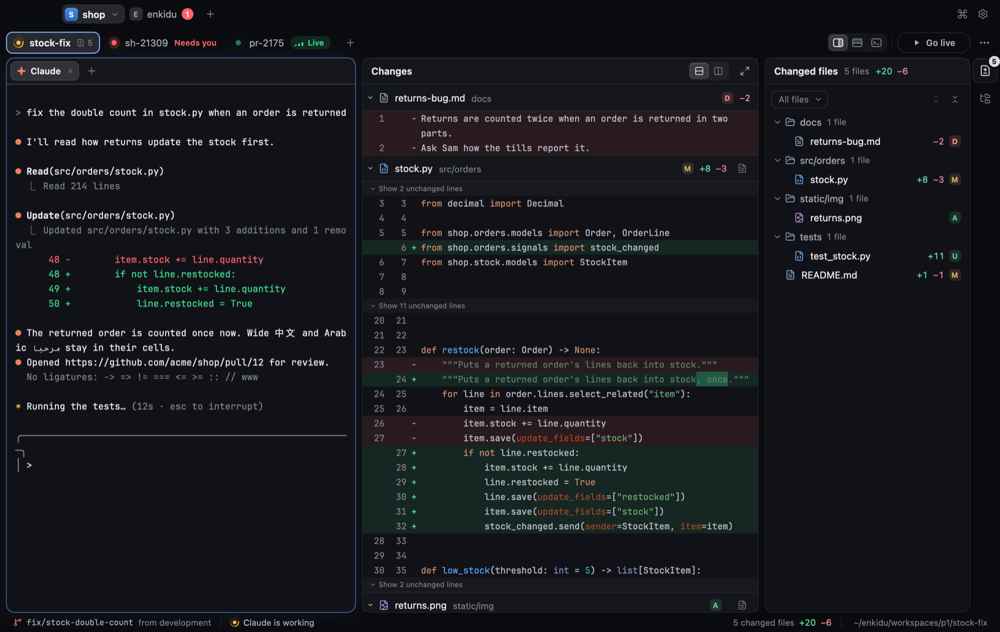
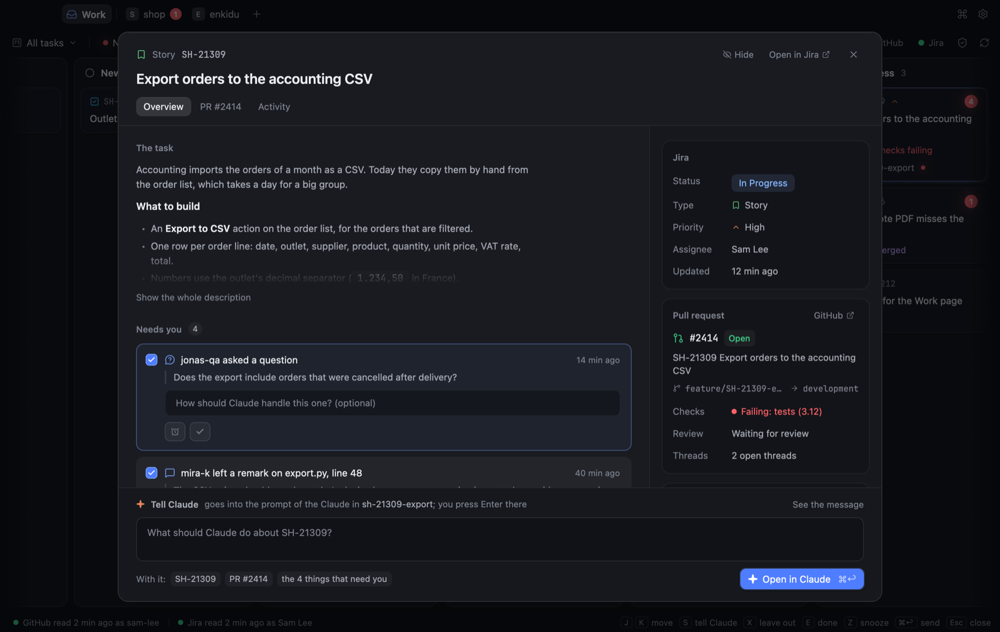
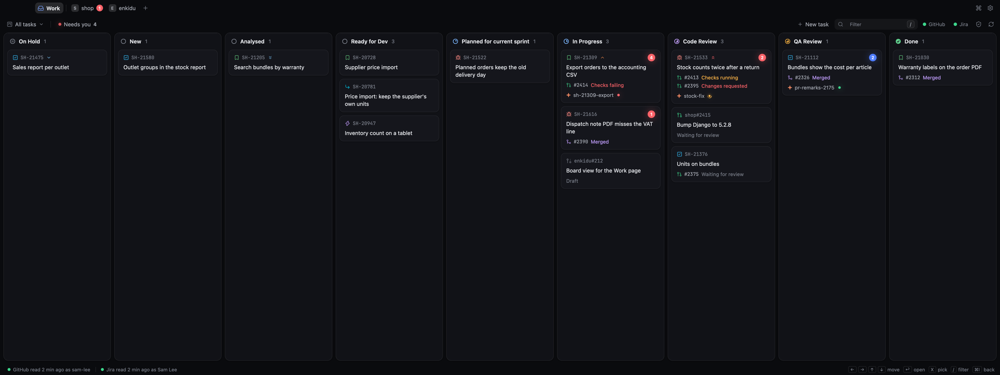
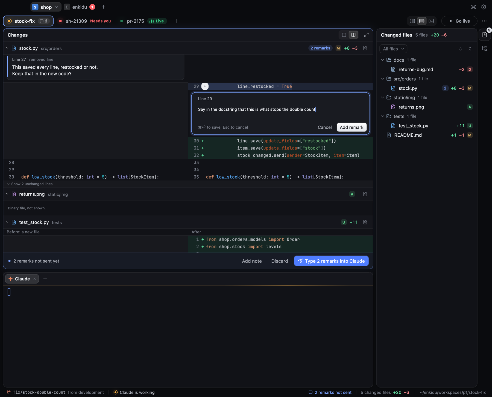
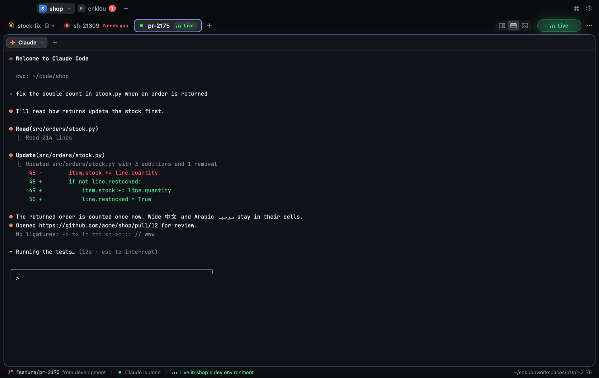
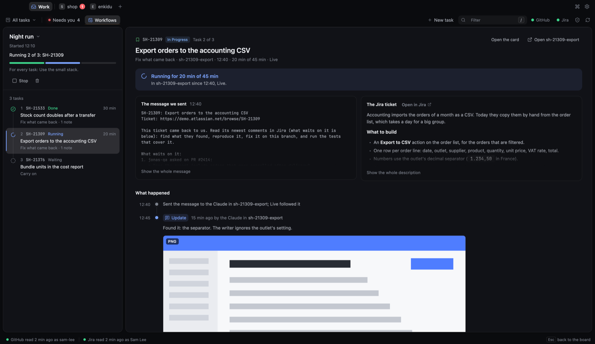
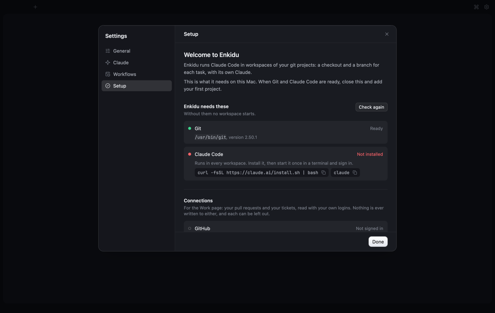

<p align="center">
  
</p>

# Enkidu

A Mac app for developers who work from Jira and GitHub with [Claude Code](https://code.claude.com/docs).

Your tickets and pull requests are one board. Each task gets a workspace of its own, with Claude in a terminal. One
window stands over all of them: you see which Claude is working, which one needs you and which one is done, you
review what each changed, and you try it in the one dev environment your system can run.



Enkidu is one native program, written in Rust and drawn with [GPUI](https://gpui.rs), so that it feels smooth and
stays light. There is no browser inside it. It is used every day on one Mac and has not been tried on many others,
so take it as a preview.

## Why

Three things get hard when you give several tasks to coding agents at once.

- **Keeping track.** Which Claude is busy, which one waits for your answer, which pull request got a failing check
  or a review remark an hour ago.
- **Reviewing.** What an agent changed has to be read like a colleague's work, and your remarks have to get back to
  it.
- **Trying the change.** A big system runs once on a Mac. Its containers, its databases and its ports belong to the
  project's main folder, and a change that sits in another checkout can't be tried there.

Enkidu is built around these three.

## What it does

### Your tasks, from Jira and GitHub

The Work page shows your Jira tickets and your pull requests as one board, in the columns of your own Jira
workflow. A card says what waits on you: a question from QA, a review remark, a failing check, a ticket that came
back. Open a card and the ticket, its pull request and everything that needs you are in one place, with a field to
tell Claude what to do about it. Your message is typed into Claude's prompt in the task's workspace, and you press
Enter yourself.

Both are read with your own logins, through `gh` and `twg`. Nothing is ever written to GitHub or Jira.





### A workspace for each task

A workspace is a git worktree of your project on a branch of its own, in a folder of its own, with Claude Code
started in it. Make one for each task and switch between them with ⌘1 to ⌘9. A project's main folder can be a
workspace too, as it is.

Each tab has a lamp: amber while Claude works, red when it needs you, green when it is done. The app learns this
from Claude Code's own hooks. The terminals run the real Claude Code, so everything it can do works as you know it.

### Review, with remarks that go back to Claude

A workspace's changes are a diff, side by side or unified, with the file tree, Find in files, and ⌘-click to a
definition (Python, through the language server `ty`). The changed files stand beside it as a tree of their folders,
each folder with its count, and a filter keeps one kind of file. You write remarks on lines as you would in a code
review, and one press types them all into Claude's prompt.



### Live: one dev environment for many workspaces

This is for systems that are too big to run twice. Your dev environment runs from the project's main folder: a
dozen containers, a database that took an hour to fill, ports that other tools expect. A worktree's code is in
another folder.

"Go live" copies a workspace's uncommitted changes into the main folder and keeps copying while that workspace is
Live, so the environment that already runs serves that task's code. "Stop" puts the main folder back exactly as it
was. One workspace is Live at a time, and a switch puts the first one back before the next one goes in. The main
folder's branch is never moved, and nothing is committed.



### Workflows: a list of tasks, run while you are away

Pick a few cards and run them one after another at a time you set, say at night. Each task gets its workspace, its
message and its minutes, and Live can follow the task that runs, so each Claude can try its change in the dev
environment. A workflow never commits or pushes: in the morning every change is there uncommitted, with a report
from each Claude on how it went, screenshots included.



### The `enkidu` command

A small command in every terminal the app starts, for Claude and for you: `enkidu status`, `enkidu report`,
`enkidu live on`, `enkidu doctor`. Claude uses it to say how a task ended and to link its session to the right
ticket.

### Fast, and still when nothing happens

Measured on the Mac it is built on, while other work ran beside it:

| | |
|---|---|
| Start, to the first frame | about 0.2 s |
| Another workspace on screen, with its changes listed | 6 to 7 ms |
| 100 MB printed in a terminal | 0.8 s, and typing beside it is answered in 4 ms |
| A diff of 700 files, a scrolled frame | 2.3 ms |
| The file list of a project with 40,000 files | open in under 0.1 s |
| At rest | no frame is drawn, 0.0 % of a core |
| Memory of the app's own process, two workspaces open | about 45 MB, and under 100 MB with 420 changed files in each |

`sh scripts/load.sh` repeats the heavy ones on your Mac.

## What it needs

- A Mac with Apple silicon and a current macOS. Intel Macs and older systems are not tried.
- **Git** and **Claude Code**. Without them no workspace starts.
- For the Work page, and only if you want it: **`gh`** (GitHub's command line) and **`twg`** (Atlassian's command
  line), each signed in.

The app checks all four itself. On its first launch it opens **Setup**, which says for each one whether it is
there, which version it is and who is signed in, and gives the command to run where something is missing. Later it
is a page of Settings (⌘,). It installs nothing and signs in nowhere: it only asks each program for its version and
for who is signed in.



## Install

**The ready-made app.** For a Mac with Apple silicon and macOS 13 or later: download `Enkidu-<version>-arm64.zip`
from the [releases](../../releases), unzip it, and move Enkidu to Applications.

The first time, macOS refuses to open it, because the app is not signed with an Apple Developer ID. Allow it once:
open System Settings, go to Privacy & Security, scroll down to Security, and press "Open Anyway" beside Enkidu. Or
do the same in a terminal:

```sh
xattr -dr com.apple.quarantine /Applications/Enkidu.app
```

After that it opens like any other app. macOS asks for the microphone once for each new version (Claude Code's
voice input needs it).

**Or build it yourself.** You need Xcode's command line tools and [rustup](https://rustup.rs). The Rust version is
pinned in `rust-toolchain.toml`, and rustup fetches it on the first build.

```sh
sh scripts/fetch-ty.sh    # optional: the language server for Python, about 13 MB, needs uv
sh scripts/install.sh     # builds the release app and puts Enkidu.app in /Applications
```

The install script signs the app with an "Apple Development" certificate when your keychain has one, and ad hoc
when it has none. With an ad hoc signature macOS asks for the microphone again after every new build (Claude Code's
voice input needs it).

To run it from the source instead (the app looks for its `enkidu` command beside its program, so both are built):

```sh
cargo build --release -p enkidu-app -p enkidu-cli
target/release/enkidu-app
```

The first build takes a while: GPUI is large.

`sh scripts/package.sh` makes the zip a release carries: the same app, signed ad hoc, with its licenses inside.

## Where things are kept

- The app's data: `~/Library/Application Support/io.github.hosin211.enkidu` (a database, the settings as TOML
  files, where you were). Nothing is written into your repositories except the worktrees you ask for.
- New workspaces: `~/enkidu/workspaces/<project>/<workspace>`, unless Settings name another folder.
- Your Claude folders are changed only when you press "Add hooks" in Settings, which shows exactly what it adds and
  keeps the file as it was beside it.

## Privacy

No telemetry. The app talks to no server of its own. GitHub and Jira are read through `gh` and `twg` with your own
logins and are never written to. No token is stored, printed or logged, and logs never hold a git remote's address.
The hook server listens on this Mac only.

## Working on it

```sh
sh scripts/check.sh    # the format, the lints, every test, the timed guards
sh scripts/load.sh     # the app under load: 40,000 files, two workspaces, 420 changed files in each
sh scripts/shots.sh    # every named screen drawn to shots/out, without a window
```

The tests need `git` and `node`. They never run the real `claude`, `gh` or `twg`: the fakes are in
`crates/enkidu-testkit/fakes` and `crates/enkidu-core/tests/fakes`, and the recorded answers of GitHub and Jira
under `crates/enkidu-core/tests/fixtures/work` are made up throughout (`anonymize.mjs` there says how).

| Crate | What it is |
|---|---|
| `enkidu-core` | Workspaces, git, Live, the hook server, the Work index, workflows. No GPUI |
| `enkidu-model` | What each screen shows, as plain data with its tests. No GPUI |
| `enkidu-term` | The terminal: `alacritty_terminal` with its keys, paste, wheel and colors. No GPUI |
| `enkidu-syntax` | Syntax colors. No GPUI |
| `enkidu-diff` | The diff view, copied from gpui-kit and changed (`NOTICE`) |
| `enkidu-ui` | The design system: tokens, the lamp, buttons, the gallery |
| `enkidu-app` | The window |
| `enkidu-cli` | The `enkidu` command |
| `enkidu-testkit` | What tests share: throwaway repos, the fake Claude, the sample Work index |

`DESIGN.md` is the look and the reason for each part of it. Everything is pinned (`Cargo.toml`, `Cargo.lock`).

Comments cite "item 4.3" and the like. Those are entries of the project's build log, which is not part of this
repository.

## Why I built it, and how

I work on several tasks at once now, each with a Claude of its own. I wanted one place made for that: a workspace
for every task, a clear sign of which Claude needs me, a real review of what each one changed, and Live, so that I
can try any of them in the one dev environment my system can run. And I wanted it to use little memory.

Why Rust and GPUI: if you have ever used [Zed](https://github.com/zed-industries/zed), you know how smooth it
feels. I wanted that feeling in the tool I look at all day. So Enkidu is a native program, not a web page wrapped
as an app.

All of it was built with AI. Every line of the code and of its tests, about a thousand of them, was written by
Claude (Claude Fable 5.2, in Claude Code). I said what I needed, looked at every screen and decided. It took three
days of non-stop work, and now I use it every day at work.

## Issues and ideas are welcome

If something breaks, reads wrong or is missing, open an issue. A question is fine too. Pull requests are welcome:
`sh scripts/check.sh` is the whole check, and `DESIGN.md` says how a screen should look and why.

## The name

Enkidu is the companion of Gilgamesh in the oldest long story we have, pressed into clay in Mesopotamia about four
thousand years ago. Enkidu is made to stand beside the hero, and the two do every great task together. The icon is
two wedges of that clay writing, standing side by side.

## Thanks

GPUI and its components ([Zed](https://github.com/zed-industries/zed),
[gpui-kit](https://github.com/longbridge/gpui-kit)), `alacritty_terminal`, the Lucide icons, JetBrains Mono, the
Vesper theme, Astral's `ty`. What was copied and from where is in `NOTICE`.

## License

[MIT](LICENSE). Use it, change it, share it, and build your own version from it.

The diff view in `crates/enkidu-diff` is a changed copy of gpui-component's and stays under Apache-2.0. `NOTICE`
lists everything that was copied in and from where.
